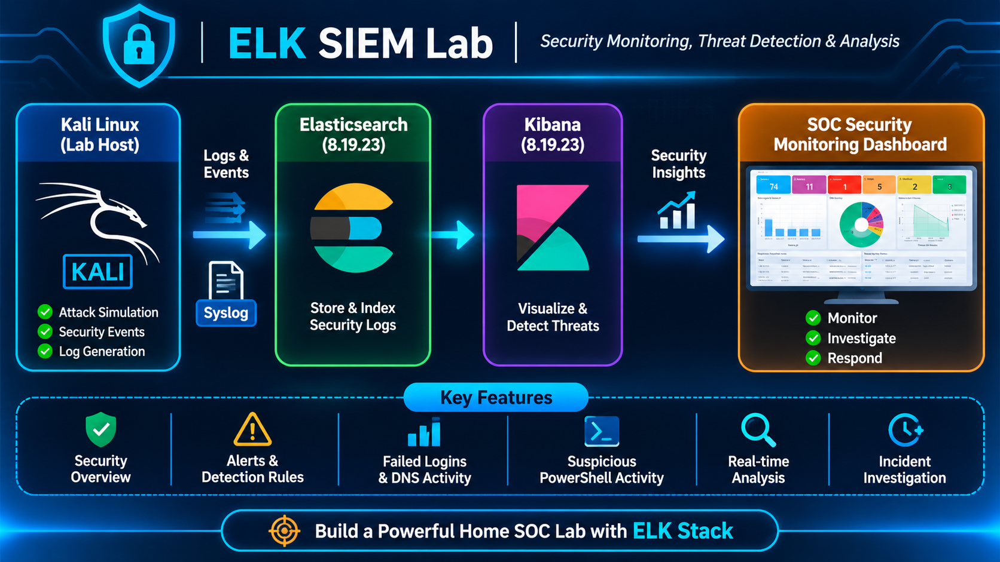
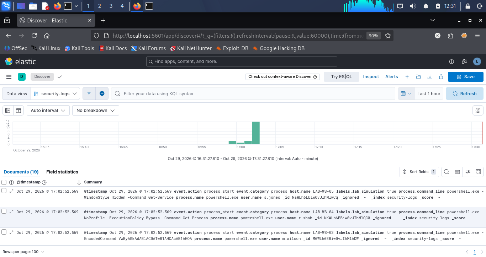
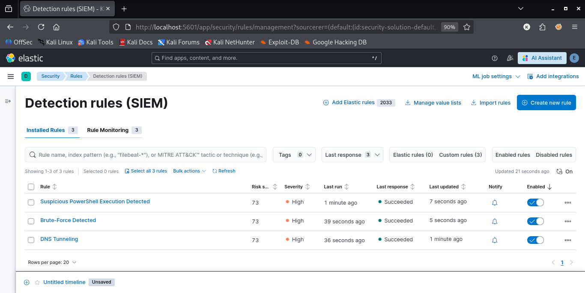
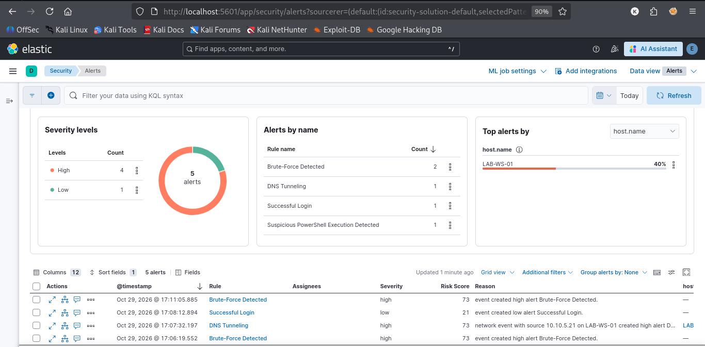
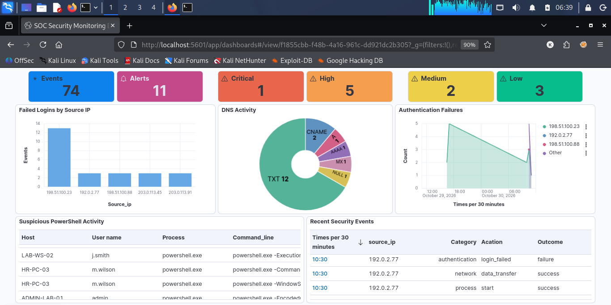

<div align="center">

# 🔎 ELK SIEM Lab

### Security Monitoring, Threat Detection & SIEM Dashboard

</div>

A practical **ELK Stack SIEM Home Lab** built on Kali Linux to learn security event monitoring, log analysis, custom detection rules, alert investigation, and SOC dashboard development.

This repository documents the implementation of Elasticsearch and Kibana, security event ingestion, custom SIEM detection rules, and a centralized SOC monitoring dashboard.

## 🎯 Objectives

The objective of this lab is to configure the ELK Stack, ingest security events, develop custom detection rules, investigate generated alerts, and create a custom SIEM dashboard for security monitoring.

## 🏗️ ELK SIEM Lab Architecture



## 🧰 Environment & Tools

| Category               | Details          |
| ---------------------- | ---------------- |
| **Operating System**   | Kali Linux       |
| **SIEM Platform**      | Elastic Stack    |
| **Elasticsearch**      | 8.19.23          |
| **Kibana**             | 8.19.23          |
| **Data Index**         | `security-logs`  |
| **Data View**          | `security-logs`  |
| **Detection Platform** | Kibana Security  |
| **Dashboard**          | Kibana Dashboard |
| **Web Browser**        | Firefox          |

---

## 1. ELK Stack Setup

Elasticsearch and Kibana were installed and configured on Kali Linux.

Access Kibana through the browser:

```text
http://localhost:5601
```

Verify that Elasticsearch and Kibana are running correctly before proceeding with log analysis.

## 2. Security Logs Index

The `security-logs` index was used to store and search security events.

A Kibana data view was configured to access the ingested security logs and support event investigation.



---

## 3. Custom SIEM Detection Rules

Three custom detection rules were configured in Kibana to identify potentially suspicious activities.

### 3.1 Brute-Force Detection

**Rule Name:** `Brute-Force Detected`

**KQL Query:**

```text
event.category: "authentication" AND event.outcome: "failure"
```

**Configuration:**

- Severity: High
- Risk Score: 73
- Check Interval: 5 minutes
- Additional Look-back: 6 minutes
- Group By: `source.ip.keyword`
- Threshold: 3 events

**Purpose:** Identify repeated authentication failures that may indicate brute-force activity.

### 3.2 DNS Tunneling Detection

**Rule Name:** `DNS Tunneling`

**KQL Query:**

```text
network.protocol: "dns" AND dns.question.type: ("TXT" OR "NULL" OR "CNAME")
```

**Configuration:**

- Severity: High
- Risk Score: 73
- Check Interval: 5 minutes
- Additional Look-back: 6 minutes

**Purpose:** Identify potentially suspicious DNS query patterns that may be associated with DNS tunneling.

### 3.3 Suspicious PowerShell Detection

**Rule Name:** `Suspicious PowerShell Execution Detected`

**KQL Query:**

```text
process.name: "powershell.exe" AND process.command_line: (*bypass* OR *hidden* OR *iex* OR *downloadstring* OR *encodedcommand*)
```

**Configuration:**

- Severity: High
- Risk Score: 73
- Check Interval: 5 minutes
- Additional Look-back: 6 minutes

**Purpose:** Identify potentially suspicious PowerShell commands and execution patterns.



---

## 4. Generated Security Alerts

The configured detection rules were tested using security events in the `security-logs` index.

The following detection alerts were generated:

- Brute-Force Detected
- DNS Tunneling
- Suspicious PowerShell Execution Detected



---

## 5. Custom SOC Security Monitoring Dashboard

A custom Kibana dashboard named **SOC Security Monitoring Dashboard** was created to organize important security information in one place.

The dashboard includes:

- Security overview metrics
- Total security events and generated alerts
- Critical, High, Medium, and Low alert counts
- Failed logins by source IP
- DNS activity visualization
- Authentication failures over time
- Suspicious PowerShell activity
- Recent security events



This dashboard helps SOC analysts monitor security activity, identify potentially suspicious patterns, and investigate events efficiently.

---

## 🎯 Conclusion

This lab provided practical experience with ELK Stack configuration, security log analysis, custom SIEM detection rules, alert monitoring, and dashboard development.

It demonstrates how Elasticsearch and Kibana can be used to centralize security events, identify potentially suspicious activities, and support SOC monitoring and investigation workflows.

---

## 👤 Author

**Pritesh Kalsariya**

**LinkedIn:** [Pritesh Kalsariya](https://www.linkedin.com/in/pritesh-kalsariya-4529a833b)

**Project:** ELK SIEM Lab
